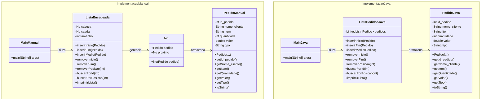

# Arquitetura do Sistema — Gestão de Pedidos de uma Lanchonete

## 1. Visão arquitetural

O projeto foi organizado em dois módulos independentes, desenvolvidos com o objetivo de implementar e comparar duas abordagens de gerenciamento de listas encadeadas em Java.

As implementações compartilham a mesma finalidade funcional: organizar, inserir, consultar e remover pedidos de uma lanchonete.

Entretanto, apresentam diferenças na construção e no gerenciamento da estrutura de dados:

- **Implementação manual:** utiliza classes próprias para representar os nós e controlar as referências entre os elementos.
- **Implementação com LinkedList:** utiliza a classe `LinkedList`, disponibilizada pela biblioteca padrão do Java, encapsulada por uma classe específica do projeto.

A arquitetura permite analisar como diferentes estratégias de implementação podem atender aos mesmos requisitos funcionais.

## 2. Organização dos pacotes

O projeto apresenta a seguinte organização:

```text
br.edu.ifgoiano.gestaopedidoslanchonete
│
├── GestaoPedidosLanchonete.java
│
├── implementacaomanual
│   ├── Main.java
│   ├── Pedido.java
│   ├── No.java
│   └── ListaEncadeada.java
│
└── implementacaojava
    ├── Main.java
    ├── Pedido.java
    └── ListaPedidosJava.java
```

A separação em pacotes permite manter as implementações independentes, inclusive com classes `Pedido` distintas.

Essa organização evita conflitos de nomenclatura e facilita a análise comparativa entre as duas abordagens.

## 3. Componentes da implementação manual

### 3.1. Classe Main

Responsável por iniciar a execução da implementação manual.

Suas principais atribuições são:

- Instanciar a estrutura `ListaEncadeada`.
- Criar os objetos `Pedido`.
- Embaralhar os pedidos utilizando `Collections.shuffle()`.
- Distribuir os pedidos conforme sua classificação.
- Executar operações de consulta, inserção e remoção.
- Apresentar os resultados no terminal.

A distribuição considera três classificações:

| Tipo de pedido | Operação |
|---|---|
| Urgente | Inserção no início |
| Prioritário | Inserção na posição intermediária |
| Normal | Inserção no final |

### 3.2. Classe Pedido

Representa os pedidos registrados no sistema.

Seus atributos são:

- `id_pedido`: identificador do pedido.
- `nome_cliente`: nome do cliente.
- `item`: produto solicitado.
- `quantidade`: quantidade solicitada.
- `valor`: valor armazenado para o pedido.
- `tipo`: classificação do pedido.

Os atributos possuem visibilidade privada e são disponibilizados por métodos getters.

O construtor também aplica regras de acréscimo ao valor informado:

- Urgente: acréscimo de 20%.
- Prioritário: acréscimo de 10%.
- Normal: mantém o valor original.

O método `toString()` permite apresentar os dados do pedido no terminal.

### 3.3. Classe No

Representa cada elemento da lista simplesmente encadeada.

Possui dois atributos:

- `pedido`: referência para um objeto da classe `Pedido`.
- `proximo`: referência para o próximo nó.

O construtor recebe um pedido e inicializa a referência `proximo` com `null`.

Os atributos possuem visibilidade de pacote, permitindo seu acesso pelas classes da mesma implementação.

### 3.4. Classe ListaEncadeada

Responsável pelo gerenciamento da estrutura de dados.

Mantém três atributos principais:

| Atributo | Responsabilidade |
|---|---|
| `cabeca` | Referência para o primeiro nó |
| `cauda` | Referência para o último nó |
| `tamanho` | Quantidade de elementos armazenados |

Disponibiliza operações para:

- Verificar se a lista está vazia.
- Consultar seu tamanho.
- Obter cabeça e cauda.
- Inserir elementos no início, meio e fim.
- Remover elementos do início, meio e fim.
- Buscar pedidos por identificador.
- Buscar pedidos por posição.
- Imprimir toda a lista.
- Exibir uma quantidade determinada de pedidos.

A classe controla manualmente as referências entre os nós, atualizando a cabeça, a cauda e o tamanho conforme as operações realizadas.

## 4. Componentes da implementação com LinkedList

### 4.1. Classe Main

Responsável pela execução da segunda abordagem.

Apresenta praticamente o mesmo roteiro funcional da implementação manual, permitindo comparar os resultados obtidos.

Suas atribuições incluem a criação dos pedidos, classificação, distribuição, consultas, remoções e apresentação dos resultados.

### 4.2. Classe Pedido

Representa os pedidos da implementação com LinkedList.

Possui os mesmos atributos, regras de acréscimo e métodos da classe `Pedido` da implementação manual.

A duplicação da classe mantém a independência entre os pacotes.

### 4.3. Classe ListaPedidosJava

Funciona como uma camada de gerenciamento da estrutura disponibilizada pela biblioteca Java.

Seu principal atributo é:

```java
private LinkedList<Pedido> pedidos;
```

A estrutura é inicializada no construtor:

```java
public ListaPedidosJava() {
    this.pedidos = new LinkedList<>();
}
```

A classe encapsula as operações da biblioteca, disponibilizando métodos próprios para o sistema.

| Operação do sistema | Método utilizado na LinkedList |
|---|---|
| Inserir no início | `addFirst()` |
| Inserir no final | `addLast()` |
| Inserir no meio | `add(posicao, pedido)` |
| Remover do início | `removeFirst()` |
| Remover do final | `removeLast()` |
| Remover por posição | `remove(posicao)` |
| Consultar por posição | `get(posicao)` |
| Consultar tamanho | `size()` |
| Verificar lista vazia | `isEmpty()` |

A classe também implementa a busca por identificador e os métodos de impressão e exibição dos próximos pedidos.

## 5. Diagrama UML de classes

O diagrama apresenta os relacionamentos estruturais entre os componentes das duas implementações.



**Observação:** o diagrama representa as duas implementações separadamente. A classe `LinkedList` é uma estrutura da biblioteca padrão do Java e não foi representada como classe interna do projeto.

## 6. Fluxo de execução

As duas implementações seguem uma sequência operacional semelhante.

### 6.1. Inicialização

A classe `Main` instancia a estrutura de gerenciamento correspondente.

### 6.2. Criação
